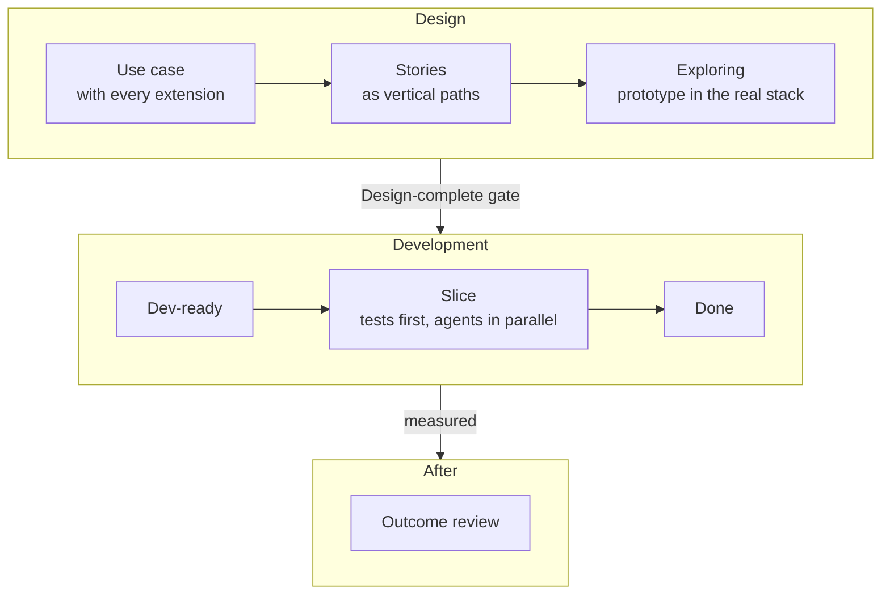

# 0. Overview

A framework for a small team to **design** product features, with Claude Design or Figma kept in step with code, and then **develop** several of them **in parallel** with Claude Code and git worktrees. It starts from use cases, goes through user stories and design-complete PRDs, and ends with slices that ship and are measured.

This repository holds the framework only: this guide, the [templates](../templates/), the [skill specs](../skills/), the [Foundations](../foundations/) for onboarding, and the research behind them. **Nothing is built or installed here**; the product, its plugins and its skills live in the product monorepo [R1-Q1, R1-Q2]. Decision IDs in brackets, such as [R4-Q8′], point to the [decision log](../grilling-log.md), which is authoritative where the guide is unclear.

## 0.1 The idea in one page

- **Edge cases come from use cases.** Every step of a fully dressed use case is checked against a list of failure types, and every extension is claimed by a story or explicitly deferred. `coverage.md` shows the gaps ([chapter 1](01-lifecycle-and-gates.md)).
- **One story = one PRD = one slice = one PR** [R1-Q9]. Work no story owns is an enabler slice.
- **Three layers stay apart:** the **flow** of each PRD, the global **look** (tokens, components, motion), and the **voice** (a global guide plus a copy deck per PRD) [R1-Q4].
- **Code is the source of truth.** Figma and Claude Design are spokes around it; each PRD explores in one of them, and the gate artefact is always a prototype in the real stack ([chapter 6](06-design-system-and-figma.md)) [R1-Q3, R18-Q1, R18-Q2].
- **Gates are checked by a script and signed by people.** Two people sign each design gate; review agents check designs and code, but don't decide ([chapters 1](01-lifecycle-and-gates.md), [9](09-review-lanes.md)) [R4-Q1, R4-Q12].
- **Specs are English Gherkin**, whatever language a PRD is written in; the scenarios are the acceptance criteria and become the tests ([chapter 8](08-testing.md)) [R3-Q1a, R3-C1].
- **Every PRD says what it should achieve** and how that is measured, and is reviewed against it after it ships ([chapter 10](10-outcomes-and-measurement.md)) [R4-Q4].
- **Parallel work uses Claude Code's own worktrees**, wrapped by small scripts that give each worktree its branch and environment ([chapter 5](05-worktrees-and-parallelism.md)) [R16-Q0].

## 0.2 Chapters

| Chapter | What it covers | Read it if you… |
|---|---|---|
| [1. Lifecycle and gates](01-lifecycle-and-gates.md) | Statuses, every gate's checklist, who signs, changing things after a gate | need the rules |
| [2. Artifacts and IDs](02-artifacts-and-ids.md) | Every artifact, its ID, where it lives, its frontmatter, traceability | write or check specs |
| [3. Design playbook](03-design-playbook.md) | From use case to a design-complete PRD, step by step | design |
| [4. Development playbook](04-dev-playbook.md) | From a dev-ready PRD to a merged slice | build |
| [5. Worktrees and parallelism](05-worktrees-and-parallelism.md) | Branches, worktrees, start scripts, environments, limits | work on several things at once |
| [6. Design system and Figma](06-design-system-and-figma.md) | Tokens, components, motion, Figma and Claude Design, where everything lives | touch the look |
| [7. i18n and voice](07-i18n-and-voice.md) | Voice guide, copy decks, catalogs, translation review | write copy |
| [8. Testing](08-testing.md) | Every test layer, Gherkin rules, security, privacy, AI evals, coverage | write or review tests |
| [9. Review lanes](09-review-lanes.md) | The code, security and UX review lanes | review or are reviewed |
| [10. Outcomes and measurement](10-outcomes-and-measurement.md) | Benefits, metrics, tracking plan, dimensions, outcome review | define success |
| [11. Tooling and plugins](11-tooling-and-plugins.md) | Recommended plugins and skills, pins, wiring | set up Claude Code |
| [12. Skills to build](12-skills-to-build.md) | Our own skills, their specs, build order, evals | build the tooling |
| [13. Adoption](13-adoption.md) | Bringing the framework into an existing monorepo | start |

## 0.3 Where to start

| You are | Read |
|---|---|
| New to the team | [Foundations](../foundations/README.md) for your role (a core path of up to 6 hours), then this overview and chapter 1 |
| Designing a PRD | Chapters 1, 3, 6 and 7; the [templates](../templates/README.md) |
| Building a slice | Chapters 1, 4, 5, 8 and 9 |
| Setting the framework up | Chapters 13, 11 and 12 |

## 0.4 What the framework leaves out

- **Discovery:** interviews, research and the personas and journeys they produce happen outside the framework; their results arrive as inputs [R11-Q11].
- **Technical choices:** the infrastructure, observability stack, analytics and BI tools, and the warehouse model are decided by ADRs in the monorepo; the framework only says when an ADR is needed [brief, R4-Q4d, R23-Q1].
- **Release:** how a Done slice reaches production (feature flags, rollouts) is outside the framework; Foundations explains the ideas [R11-Q12].
- **The other "-ilities":** performance, load and availability testing are separate [brief, R12-Q5].
- **Native mobile:** web only for now, built so native can follow [R3-Q8].
- **The company website**, which lives in its own repository [R2-Q10].

## 0.5 Changing the framework

The decision log is the source. A change starts as a new round in [`grilling-log.md`](../grilling-log.md), then the guide is updated, citing the new decision. After the first and third PRDs, a retrospective feeds that loop [R5-Q6, R26-Q3].
