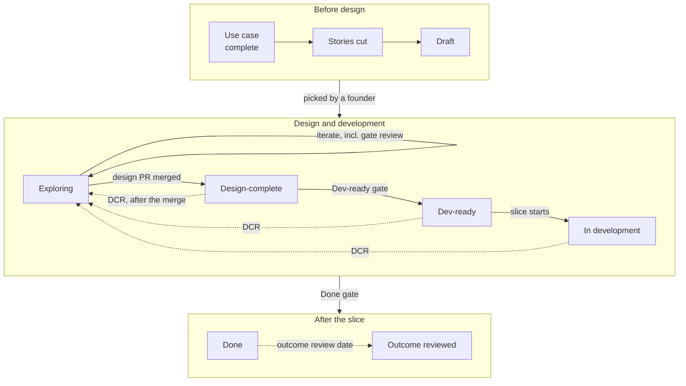

# 1. Lifecycle and Gates

This chapter defines the statuses each artifact moves through, the gate that guards each move, who signs it, and how the gate is enforced. Decision IDs in brackets point to [`../grilling-log.md`](../grilling-log.md), which is authoritative where this chapter is unclear.

Artifacts and their IDs (`UC-012`, `US-012.1`, `PRD-012.1`, `ENB-004`, `DCR-012.1-01`, `ADR-0007`, `TRD-012.1`) are defined in [chapter 2](02-artifacts-and-ids.md). How to do the work inside each status is in the [design playbook](03-design-playbook.md) and the [dev playbook](04-dev-playbook.md).

## 1.1 The shape of the flow

- **Design** covers everything up to Design-complete. The three personas (PM, UX, Eng) review only here [R1-Q12]. Iterating in *Exploring*, including rounds of review on the open design PR, needs no DCR; a DCR is needed only once the design PR has merged [R2-Q4, R18-Q7].
- **Development** covers Dev-ready to Done. No persona reviews; the review lanes take over [R4-Q7′].
- **Granularity:** one user story = one PRD = one slice = one slice PR [R1-Q9]. Work that no single story owns is an **enabler slice** (`ENB-…`) [R3-A3].
- **Status lives in each artifact's frontmatter** (`status:`), and `docs/product/index.md` is generated from it. There is no separate tracker [R3-A4]. A PRD in *Exploring* has that status only on its `design/` branch, so the index lists every open `design/PRD-…` branch as *Exploring* [R28-Q12].

## 1.2 PRD statuses

| Status | Meaning | Where the work happens |
|---|---|---|
| `Draft` | A story exists: its statement, the use-case steps it follows, `extensions:` and `touches:` [R28-Q4]. | `docs/product/use-cases/UC-…/stories/US-…/` on `main` |
| `Exploring` | Flows, screens, copy and prototypes are iterated freely. No reviews. | A `design/PRD-…` branch and worktree [R1-Q10, R4-Q5′] |
| `Design-complete` | The design is signed off. Its `.feature` files are frozen [R3-Q1a]. The design PR has merged into `main`. | `main` |
| `Dev-ready` | Everything a developer needs is decided: ADRs accepted, TRDs written, blocking enablers scheduled. | `main` |
| `In development` | The slice is being built. | A `slice/PRD-…` branch and worktree |
| `Done` | The slice PR has merged. The PRD is now a point-in-time record and is not rewritten [R4-Q8e′]. | `main` |

After `Done`, the lifecycle has no more statuses. The **outcome review** is a section of the PRD that is filled in on a set date [R4-Q4e].

**Enabler slices** follow a shorter lifecycle, `Draft → Dev-ready → In development → Done`, with no design phase [R7-Q2]. The exception is an enabler that adds a design-system component: it goes through *Exploring* and the UX persona review before Dev-ready.

**Design change requests** have their own status, `Exploring → Design-complete` [R7-Q3]. The PRD's own `status:` does not change while a DCR is open. The PRD lists the DCR under `open_dcrs:`, and the tickets it affects pause until it closes.

## 1.3 Before a PRD exists: the use case gate

A use case moves from `Draft` (being written or clarified) to `Complete` (signed off by its driver; stories may now be cut from it) [R28-Q11]. The work happens on a plain branch, `uc/UC-012-<slug>`. Reviewers comment on the PR that sets `Complete`, and the gate check runs on it; the same PR may also cut the stories [R28-Q20].

Stories are only cut from a **complete** use case [R4-Q2]. A use case is complete when:

1. It is at the **user-goal level**: one primary actor, in one sitting, leaves with the goal reached (Cockburn's coffee-break test). A summary goal is only an optional map of the user-goal use cases it groups; a subfunction is a step, not a use case [R28-Q1]. See [goal levels](../foundations/pm-lens.md#22-goal-levels).
2. Every field of the Cockburn "fully dressed" format is filled [R1-Q6]. Steps state intent, not screens or clicks [R28-Q7].
3. Every main-scenario step is marked `(actor)` or `(system)` and has been run through the **failure categories of its kind** [R4-Q2, R28-Q6]:

   | Step kind | Categories |
   |---|---|
   | **Actor** step: the actor provides or chooses something | invalid input · duplicate · no permission · cancel or abandon |
   | **System** step: the system looks up, stores or calls something | not found · conflict or concurrent edit · timeout or external system down · partial failure · quota or limit reached · stale data |

   **Privacy request** is asked once per use case: can the actor ask to export or erase the personal data it handles?
4. Each resulting extension has a handling outcome and a one-line **example** with a concrete instance, or is marked `deferred` or `out-of-scope` with a reason [R1-Q7, R28-Q3].
5. Stakeholders and their interests are listed.
6. The inputs it draws on (personas, journeys) are cited by ID [R3-A5].

Stories are then cut as **vertical paths** that deliver value on their own: the first is the thinnest path through the whole main scenario, and each later one adds extensions or one variation [R28-Q8]. Each passes INVEST ([explained in chapter 3](03-design-playbook.md#cutting-stories)) and fits about one week of slice work [R4-Q3]. Several stories may claim the same extension [R28-Q9]. Extensions that no story claims yet stay visible in the generated `coverage.md`.

**Step and extension IDs** (`UC-012.3a`) are renumbered only by `write-use-case renumber`, which rewrites every reference, and only until a PRD that references them reaches Design-complete. After that, the use case only grows: an inserted step takes a decimal number (`3.1`), a removed one is marked `retired`, and no ID is ever reused [R28-Q19′].

## 1.4 Draft → Exploring

**Entry condition** [R28-Q4]: a story with its statement, `extensions:` and `touches:` (`ui`, `api` or both). It has no acceptance criteria yet: the Gherkin scenarios are written during *Exploring*, starting from the examples of its extensions. `touches:` may change until Design-complete; after that, only through a DCR [R28-Q18].

**Who moves it:** a founder picks the PRD **manually and explicitly**. The `priority:` field in the frontmatter informs the choice but does not make it [R6-Q1]. The driver then runs `make design`, which checks the limit, records the design tool, sets the status and opens the worktree in one step [R28-Q17].

**Limits** [R4-Q6]:
- at most **3 PRDs in *Exploring* per driver**, counted from open `design/` branches [R28-Q12];
- enabler slices that block feature slices go first.

**Inside *Exploring*, anything goes** [R2-Q4]. There are no reviews and no gate checks. The driver explores in **one** design tool per PRD, either Figma or Claude Design, recorded as `design_tool:` in the frontmatter and fixed once *Exploring* starts [R18-Q4]. Whatever the tool, only the real-stack prototype and the markdown artifacts count at the gate [R1-Q5, R18-Q2].

## 1.5 Exploring → Design-complete

This is the main design gate. It is passed through the **design PR** from `design/PRD-…` into `main` [R4-Q5′]. Rounds of review and fixes on the open design PR are still *Exploring*: no DCR is needed until it merges [R18-Q7].

### Checklist

Items marked **(ui)** apply only when the PRD's `touches:` includes `ui`, and **(api)** only when it includes `api`; the gate check reads `touches:` to know which files to require [R28-Q5].

| Item | Requirement | Decision |
|---|---|---|
| (a) | Use-case extension coverage is green: every extension the story touches maps to a scenario or is marked `deferred` / `out-of-scope`. | R2-Q3, R1-Q7 |
| (b) | BDD scenarios cover the story's main-scenario steps and every extension it claims, including failure paths, grouped under plain-English rules. They are English Gherkin in domain wording, without copy keys, and are the only acceptance criteria. | R2-Q3, R3-C1, R28-Q10, R28-Q16 |
| (c) | **(ui)** A flow map lists every screen and transition, with entry and exit points. | R2-Q3 |
| (d) | **(ui)** A **state matrix** per screen covers empty, loading, error, partial, success, no-permission and stale data. | R2-Q3 |
| (e) | **(ui)** The key information and key actions on each screen are traced to the story. | R2-Q3 |
| (f) | **(ui)** The copy deck is complete in the source language and follows the voice guide. | R2-Q3, R2-Q6 |
| (g) | **(ui)** Only design-system components are used. New components are raised as enabler slices. | R2-Q3 |
| (h) | **(ui)** Accessibility basics: focus order, keyboard use, labels, contrast through tokens. | R2-Q3 |
| (i) | **(ui)** Responsive behaviour is defined. | R2-Q3 |
| (j) | Authorisation per action: who may do what. | R2-Q3 |
| (k) | Privacy data inventory: personal data shown or collected, purpose, retention. It includes the analytics event properties, and an **AI use** part when the PRD uses an AI model (model and provider, data sent, human oversight, transparency notice, AI Act risk category). | R2-Q3, R4-Q4c, R12-Q6a |
| (l) | **(api)** A draft API contract that the prototype mocks against, written against the fit analysis. | R2-Q3, R4-Q8a |
| (m) | Technical questions are listed and linked to ADRs. | R2-Q3 |
| (n) | The PM, UX and Eng persona reviews are recorded in `reviews.md`. | R2-Q3 |
| (o) | **Expected outcome and measurement plan:** user benefits with observable signals; numeric targets once `metrics_stage: growth`; events listed in the tracking plan. | R4-Q4a–c |
| (p) | **Fit analysis** (`fit.md`): each endpoint, use case and data entity classed as reuse, extend, change or new. | R4-Q8a |
| (q) | **Strongly recommended, not mandatory:** for a PRD that adds a new flow, a light usability test of the prototype with 3–5 real users, findings in `reviews.md`. The gate check reports a missing test as a warning, not a failure. | R11-Q10 |
| (r) | **AI Act risk category:** a PRD whose §11b says `prohibited` is stopped. One that says `high-risk` (e.g. an Annex III area) needs an ADR, informed by legal advice, deciding whether and how to proceed. The gate check blocks both until resolved. | R14-Q1 |

### Reviews and sign-off

- The **UX review lane's guideline checks** (accessibility, web guidelines, UX rules, copy and voice, state matrix) run on the prototype first. Their reports feed the UX persona [R4-Q7d].
- The **PM, UX and Eng persona reviewer agents** run on the PRD and prototype [R1-Q12]. For a PRD that adds an endpoint, a data store or a third party, the Eng review includes a short **STRIDE-style threat check** [R11-Q12], which covers **prompt injection** when the PRD sends user or third-party content to an LLM [R12-Q6c].
- **Two humans sign**: the PRD's driver plus one other founder or developer. One person may hold all three roles [R4-Q1]. With two founders, both sign every design gate.
- If the PRD **amends** scenarios of an earlier PRD (`amends:`), that earlier PRD's driver also signs [R4-Q8e′].

### What happens on merge

- The `.feature` files are **frozen**. A wording tweak for testability is allowed; any change in meaning needs a DCR [R3-Q1a].
- The prototype's screens are captured into Figma on a frozen `PRD-… / design-complete` page [R3-Q7].
- A `Proposed` ADR does **not** block this gate. It blocks the next one [R1-Q13].
- If the PRD was explored in Claude Design, its final export is saved in `design-export/` and merges with the design PR [R18-Q6].

## 1.6 Design-complete → Dev-ready

[R5-Q1]

| Requirement | Notes |
|---|---|
| Every linked ADR is `Accepted`. | If an ADR's outcome changes the UX, the PRD goes back to *Exploring* through a DCR [R1-Q13]. |
| A TRD exists wherever the standard stack and existing ADRs don't answer the PRD's technical questions. | |
| Every enabler slice this slice depends on is `Done`, or will merge before the tickets that need it. | A missing *measurement* enabler does not block this gate: the slice is built against a fake analytics port [R4-Q4d]. |
| The slice still fits about one week of work. | Otherwise split the story [R4-Q3]. |
| The PRD has no open questions left. | |

**One sign-off:** the developer who will take the slice. No personas.

## 1.7 Dev-ready → In development

The developer creates the `slice/PRD-…` branch and worktree and sets the status [R4-Q5′].

**Limit:** at most **2 slices in development per developer**; each slice may run several agents [R4-Q6].

The first step of the slice is to **refresh the fit analysis** against current `main`. If the code has moved, the tickets change. If the design must change, open a DCR [R4-Q8′].

## 1.8 In development → Done

This gate is passed through the **slice PR** into `main`. There are no personas; PM and UX only do acceptance on staging, which is not a gate [R2-Q5].

| Requirement | Decision |
|---|---|
| All Gherkin scenarios pass on the business layer with fakes; `@ui` scenarios also pass in Playwright-BDD, in every enabled locale. | R2-Q5, R4-Q8′, R14-Q2 |
| For AI features: the eval set passes its threshold when prompts or model configuration changed. | R14-Q5 |
| Technical tests pass, including integration tests against a real Postgres. | R2-Q5, R4-Q8′ |
| Security and privacy tests pass: authorisation matrix, privacy inventory, relevant OWASP ASVS L1 items, dependency and secret scanning. Slices touching the LLM gateway or AI features are also reviewed against the OWASP Top 10 for LLM Applications. | R4-Q9, R12-Q6b |
| The OpenAPI diff shows no breaking change the PRD doesn't list. | R4-Q8c |
| No review lane (code, security and privacy, UX) has an open **blocking** finding. | R4-Q7a–c |
| The events in the measurement plan are emitted, asserted in tests through the analytics port, and visible on staging. | R4-Q4c |
| Message catalogs exist for every locale; non-source strings may still be `needs-review`. | R2-Q5, R4-Q10 |
| Visual conformance is checked against the design-complete snapshot (Storybook / Chromatic or screenshots). | R2-Q5 |
| No prototype route for this PRD remains. | R4-Q11 |
| A human has reviewed the slice PR. | R2-Q5, R4-Q7′ |

**On merge:** an `as-built` page is captured into Figma [R3-Q7], and the PRD's `outcome_review_due:` is set [R4-Q4e].

## 1.9 After Done

- **Production release of translations** [R4-Q10]: every string in a locale enabled for production must be reviewed by a native speaker. A locale can be switched off in production until its review is complete. Staging has no such rule.
- **Outcome review** [R4-Q4e]: on `outcome_review_due`, the driver fills in the PRD's *Outcome review* section: `met`, `missed` or `inconclusive`, the numbers, and the follow-up (a new story, a DCR on a later PRD, or nothing). Any measurement enabler must be `Done` by then [R4-Q4d]. The generated index lists overdue reviews.

## 1.10 Changing something after a gate

| Situation | What happens | Decision |
|---|---|---|
| A UX change to a PRD that is `Design-complete`, `Dev-ready` or `In development`, found at any time | A **design change request** (`DCR-…`). Only the change goes back through *Exploring*, and the persona review covers only that change. The PRD keeps its status; the affected tickets pause until the DCR is `Design-complete`. | R2-Q4, R7-Q3 |
| A UX finding from the review lanes during the slice | Not fixed silently: it opens a DCR. | R4-Q7c |
| A purely technical change | Stays in development. No DCR. | R2-Q4 |
| An architecture gap found during the slice | A `Proposed` ADR; only the tickets it affects pause. If its outcome changes the UX, it becomes a DCR. | R13-Q3 |
| A new PRD contradicts a `Done` PRD | The earlier PRD is **not** reopened. The new PRD lists the scenarios it changes (`amends:`), its design PR edits the older `.feature` files, and the earlier PRD gains `amended_by:`. | R4-Q8e′ |
| A new PRD contradicts a PRD that is `Dev-ready` or `In development` | Not allowed directly. The change goes to that PRD as a DCR; the new PRD waits or drops the conflicting scenario. | R4-Q8e′ |
| Two PRDs in `Exploring` overlap | The two drivers settle it before either reaches Design-complete. | R4-Q8e′ |
| A bug: the code doesn't match an existing scenario | A `fix/` branch: fix it, add a regression test tagged with the scenario. No PRD. | R5-Q2 |
| Review lanes on any `fix/` PR | The code and security lanes always run; the UX lane runs when the diff touches the web app or the UI package. | R7-Q4 |
| A bug: a case is missing from the specs, the intended behaviour is clear and nothing visible changes | The fix PR adds the scenario to the `Done` PRD's `.feature` file; that PRD gains `amended_by: fix/…`; the other founder signs. | R5-Q2 |
| A bug whose fix would change the UX | A new story, through the full lifecycle. | R5-Q2 |

The current truth about behaviour is always the `.feature` files and use cases on `main`, with the generated `coverage.md`. PRDs record decisions; they are not living documents after `Done` [R4-Q8e′].

## 1.11 Enforcement

A **gate check** runs on every PR that changes a `status:` field, both as one of our own skills and as a CI job [R4-Q12]. It checks:

- the frontmatter;
- that the files the target status requires exist, scaled by `touches:` [R28-Q5];
- that the generated coverage has no gaps, and that no `UC-…` ID points nowhere or to a retired ID [R28-Q19′];
- the sign-offs in `reviews.md`;
- the status of linked ADRs;
- for `Done`: that no review lane has an open blocking finding;
- as a **warning**, that the copy of the design system in the PRD's `design_tool` was synced after the last design-system change [R18-Q3].

A failed check blocks the status change. The checks that a script can do mechanically are done by a script, so that CI needs no agent for them; the agent judges only what the script cannot ([chapter 12](12-skills-to-build.md), R5-Q4′).

## 1.12 Summary of sign-offs

| Gate | Agents | Human sign-off |
|---|---|---|
| Use case → Complete | Use-case writer and extension checker | The use case's driver, on the `uc/` PR |
| Draft → Exploring | None | A founder picks it |
| Exploring → Design-complete | UX lane guideline checks; PM, UX and Eng personas | Two people: the driver plus one other (plus earlier drivers for amendments) |
| Design-complete → Dev-ready | Gate check | The developer taking the slice |
| DCR → Design-complete | Personas, on the change only | Two people, as for the design gate |
| In development → Done | Code, security and privacy, and UX review lanes; gate check | A human review of the slice PR |
| Bug fix that adds a scenario | Code and security lanes, plus UX if the UI is touched | The other founder |
