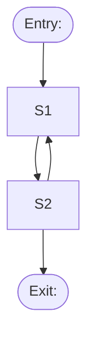

<!-- Copied to …/stories/US-012.1-<slug>/flows.md. The FLOW layer only: no colours, fonts or animation
     specs, which belong to the look layer (tokens, design system, motion) [R1-Q4]. -->

# Flows: PRD-012.1

## Flow map

<!-- Every screen and transition, with entry and exit points [R2-Q3 (c)]. -->

## Screens

<!-- One block per screen. Key information and key actions are traced to the story [R2-Q3 (e)].
     Interactions name an INTENT from docs/design/motion.md, never an animation [R3-Q6′]. -->

### S1 <screen name>

- **Purpose:** …
- **Key information:** <item> (traces to: story / UC step)
- **Key actions:** <action> → <next screen> (traces to: …)
- **Interaction intents:** `reveal details`, `confirm success`
- **Prototype route:** `src/apps/web/app/(prototypes)/<prd>/<screen>`

## State matrix

<!-- Every screen × every state [R2-Q3 (d)]. Describe what the user sees, or "n/a" with a reason. -->

| Screen | Empty | Loading | Error | Partial | Success | No permission | Stale data |
|---|---|---|---|---|---|---|---|
| S1 | | | | | | | |
| S2 | | | | | | | |

## Responsive behaviour

| Screen | Narrow | Wide |
|---|---|---|
| S1 | | |
